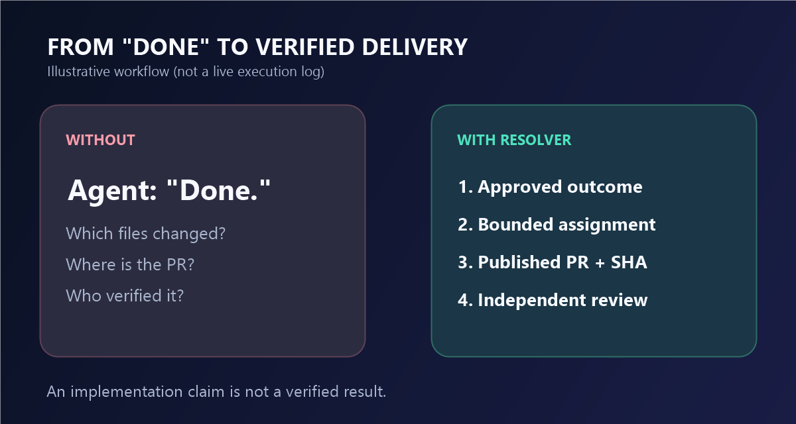

# Project Resolver

**Your AI agent says “done.” But where is the PR, who checked it, and did it meet the actual goal?**

Project Resolver is an **open-source operating method for AI-assisted projects**: keep the owner's decisions, hand work to capable agents, capture a real GitHub result, and review the evidence before calling it finished. It uses the tools you already have — not a new hosted agent service.

[](LICENSE.md)
[](https://github.com/TMCP-HUB/project-resolver/releases)
[](plugins/project-resolver/skills/project-resolver/SKILL.md)



## The difference

| Without a delivery method | With Project Resolver |
| --- | --- |
| “Done.” No clear definition of done. | The requested outcome and accepted decisions stay in scope. |
| “I changed it locally.” No durable result. | The actual branch/PR and commit identify what changed. |
| “Tests passed.” No evidence of the user's real goal. | Claim-specific checks and an independent reviewer when required. |
| Every new agent starts from scratch. | GitHub records and focused handoffs preserve continuity. |

**Start simple.** Resolver does not require multiple agents for every request. It introduces bounded roles, skills, and checks only when the task needs them.

## Install in one command

For **Claude Code, Cursor, Codex, and other compatible Agent Skills clients**, run this in the project where you want to use the skill (Node.js/npx required):

```bash
npx skills add TMCP-HUB/project-resolver --skill project-resolver
```

The installer lets you choose the target agent. For a non-interactive example:

```bash
npx skills add TMCP-HUB/project-resolver --skill project-resolver -a claude-code -y
```

You can also [browse the skill source](plugins/project-resolver/skills/project-resolver/SKILL.md) or clone this repository and give an agent its [`AGENTS.md`](AGENTS.md). The source can be read without an account or installer.

**ChatGPT plugin:** Download `project-resolver-plugin-v0.2.0.zip` from [Releases](https://github.com/TMCP-HUB/project-resolver/releases), then import the package through **Plugin Creator** if your account has that feature. The same files are under [`plugins/project-resolver/`](plugins/project-resolver/). Updating an owned private plugin can reuse its identity rather than create duplicates. Plugin Creator access is separate from model and GitHub permissions.

Installation gives your agent **instructions**, not GitHub credentials, a live worker, or independent verification by magic. Connect the tools you actually need.

## Try a real task

Give your agent this short objective, substituting your own repository and goal:

```text
Use Project Resolver from https://github.com/TMCP-HUB/project-resolver.
Target: OWNER/REPO
Goal: Fix the requested outcome while preserving decisions already made.
Reuse the existing Issue/PR and implementation. Do not add unrelated work.
Publish the actual GitHub candidate and report its exact commit.
Separate implementation from any review or acceptance that is required.
```

<details>
<summary>What happens on a larger task?</summary>

```text
Owner goal and existing decisions
       |
       v
Select relevant skills and bounded assignment
       |
       v
Capable executor publishes a real GitHub PR
       |
       v
Independent review of the exact candidate (when required)
       |
       v
Authorized merge or next step
```

The agent's host, available tools, and permissions determine which steps it can actually perform. A CI success is not, by itself, final product acceptance.

</details>

## Real GitHub change, with evidence

This repository is itself a public example of reviewable delivery. The [Apache 2.0 transition (PR #1)](https://github.com/TMCP-HUB/project-resolver/pull/1) records a real, bounded change to licensing, notices, and documentation. The [release packaging history](https://github.com/TMCP-HUB/project-resolver/commits/main/) and [Actions](https://github.com/TMCP-HUB/project-resolver/actions) provide further inspectable artifacts.

The illustration above is **not** a screenshot of that PR. Private customer work is not published as a marketing case, and we do not claim an independent review for steps where the public record does not demonstrate one.

## What it supports

- **Owners and project leads:** maintain the outcome, scope, previously approved decisions, and an actionable handoff.
- **Coding agents:** Claude Code, Codex, Cursor, and other Agent Skills-compatible tools can use the portable `project-resolver` skill. This is **skill compatibility**, not a claim that every host can run subagents or publish PRs.
- **Teams delivering software:** GitHub branches, PRs, commits, bounded implementation, risk-based verification, and explicit completion states.
- **Broader projects:** Foundation, Canon, Research, Software, and Verification methods, selected only as needed.

No permanent daemon, hosted service, new agent framework, automatic background scheduler, or universal browser requirement is bundled.

## Documentation and distribution

| Resource | Use |
| --- | --- |
| [Portable skill](plugins/project-resolver/skills/project-resolver/SKILL.md) | The entry point for compatible coding agents |
| [Setup skill](plugins/project-resolver/skills/setup/SKILL.md) | First-time setup and local-only work |
| [Architecture reference](docs/REFERENCE.md) | Existing engines, contracts, and deeper technical details |
| [Agent rules](AGENTS.md) | Source-level boundaries and operating rules |
| [Latest release](https://github.com/TMCP-HUB/project-resolver/releases) | Tagged source and downloadable private-plugin ZIP |
| [Social preview art](assets/social-preview.png) | Share graphic (repository Settings upload needed to activate it) |

**License:** [Apache License 2.0](LICENSE.md). See [NOTICE](NOTICE) and [trademark policy](TRADEMARKS.md). TMCP Hub is a project of TMC Movers LLC (North Carolina); developer: [SpillikinS](https://mixx.pages.dev).

If you find a reproducible limitation, [open an issue](https://github.com/TMCP-HUB/project-resolver/issues/new) with the expected outcome and the actual behavior. Public contributions are welcome within the existing architecture.
